# Volta Neobank — продуктовая аналитика

[](https://github.com/NikitaBoyarkin/volta-banking/actions/workflows/ci.yml)


[](LICENSE)

**▶ [Открыть аналитический борд](docs/board/volta_board.html)** — открывается в браузере, без установки, сборки и CDN · **[PRD v2](docs/prd-v2.md)** · [Быстрый старт](#быстрый-старт)

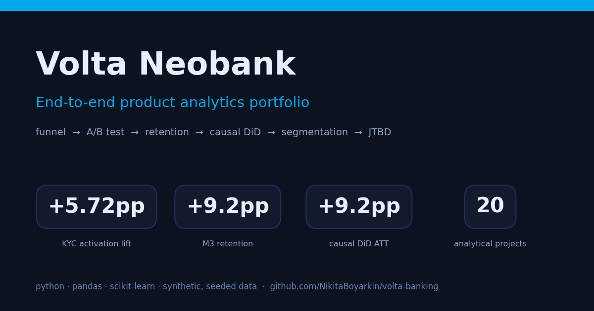

> Из 10 000 установок до первой транзакции доходят 1 269 человек; фикс KYC дал +5,72 п.п. конверсии (p < 0,0001) и +€656K в год при 44× ROI.

## Навигация

- 🌐 [Портфолио-сайт](https://nikitaboyarkin.github.io)
- 🏦 [Флагман: Volta neobank](https://github.com/NikitaBoyarkin/volta-banking)
- 🧪 Связанные: [A/B Testing Toolkit](https://github.com/NikitaBoyarkin/ab_test) · [Causal / Uplift](https://github.com/NikitaBoyarkin/causal-uplift) · [SQL Analytics Case Study](https://github.com/NikitaBoyarkin/sql-analytics-case-study) · [Churn Prediction](https://github.com/NikitaBoyarkin/churn-prediction)

**На этой странице:** [Ситуация](#ситуация) · [Задача](#задача) · [Действия](#действия) · [Результат](#результат) · [Главное](#главное) · [Решения и гейты](#решения-и-гейты) · [Быстрый старт](#быстрый-старт) · [Стек и структура](#стек-и-структура) · [Визуализации](#визуализации--остальные-проекты) · [Где читать дальше](#где-читать-дальше)

## Ситуация

Вымышленный необанк Volta после запуска: из 10 000 установок до первой
транзакции доходят 1 269 человек, а шаг KYC Complete теряет 43,4% — самая
низкая конверсия шага (56,6%). Данные синтетические, генераторы seeded и
лежат в репозитории.

## Задача

Пройти путь от сырой воронки до защищённых решениями рекомендаций: найти
узкое место онбординга, проверить фикс экспериментом, подтвердить эффект во
времени и посчитать его в деньгах.

## Действия

В рамках портфолио собраны 22 проекта — от первой установки до удержания.
Воронка вскрывает KYC как узкое место; A/B-тест с bootstrap-ДИ, CUPED и
поправками Holm проверяет прогресс-бар; когортный retention и
difference-in-differences подтверждают, что эффект выжил через месяцы; дальше
отток, сегментация, слой Market & Jobs и RAT v2, который считает в деньгах
собственные рекомендации портфолио.

## Результат

Прогресс-бар KYC: +5,72 п.п. конверсии (p < 0,0001), лифт превышает MDE, SRM
не обнаружен, гейт выката пройден — эффект на портфель +€656K в год при 44×
ROI на €15K разработки. M1 retention вырос на 11,8 п.п., M3 — на 9,2 п.п.,
инкрементальный LTV портфеля +€227K в год.

22 проекта ведут вымышленный необанк Volta от первой установки до
удержания. Сначала воронка онбординга вскрывает узкое место на KYC, потом
A/B-тест проверяет, что его правда чинят, а когортный retention и каузальный
тест difference-in-differences — что эффект выжил через месяцы. Дальше отток,
сегментация, слой Market & Jobs и слой RAT v2, который считает в деньгах
собственные рекомендации портфолио.

Все данные синтетические, генераторы seeded и лежат в репозитории — любое
число ниже можно пересобрать одной командой.

---

## Главное

### KYC — узкое место онбординга

Из 10 000 установок до первой транзакции доходят 1 269 человек, а шаг KYC
Complete теряет 43,4% — самая низкая конверсия шага (56,6%). Прогресс-бар в
A/B-тесте поднял конверсию на **5,72 п.п.** (p < 0,0001, доверительный
интервал не пересекает ноль) — гейт выката пройден, эффект на портфель
**+€656K в год** при 44× ROI на €15K разработки.

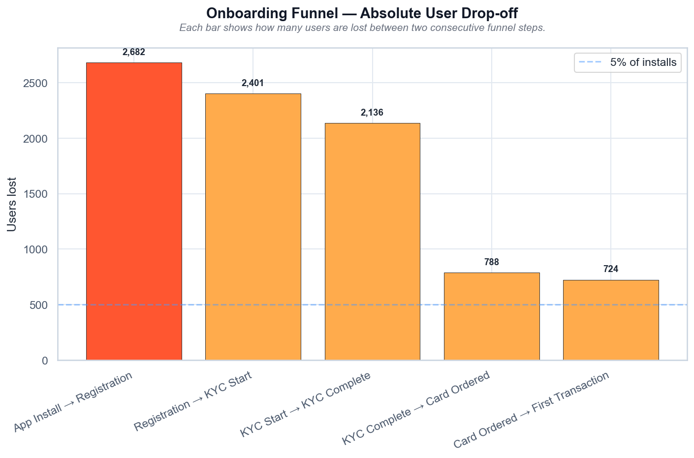
*Сколько пользователей теряется между соседними шагами. В абсолютных числах больше всех теряет «App Install → Registration» (2 682), но относительное узкое место — KYC.*

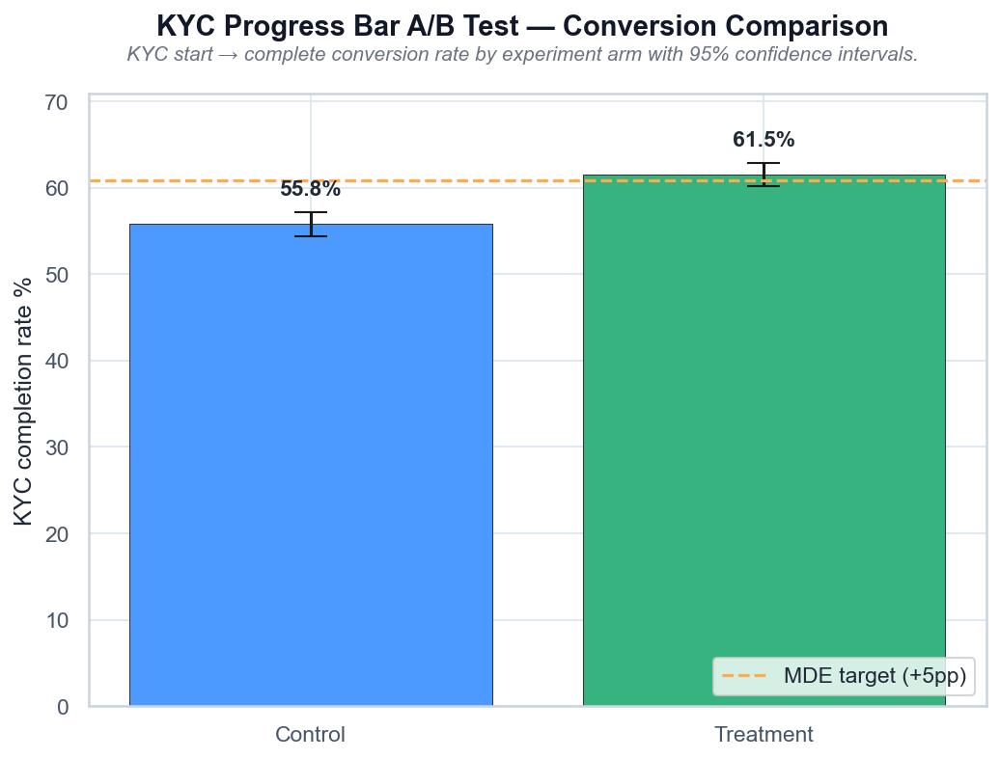
*Конверсия в первой транзакции по группам: контроль против прогресс-бара. Лифт +5,72 п.п. превышает MDE, SRM не обнаружен.*

### Эффект выжил в когортах

M1 retention вырос на 11,8 п.п., M3 — на 9,2 п.п., инкрементальный LTV
портфеля **+€227K в год**. Premium удерживаются лучше Free: LTV в 4,3× выше,
и это не артефакт только по ARPU — у Premium своя кривая удержания, M6 ≈ 60%
против Free 31%.

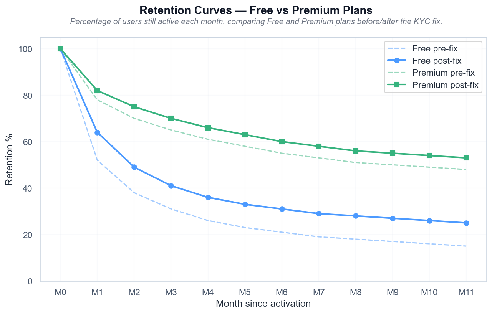
*Доля активных по месяцам до и после починки KYC. Premium держится заметно выше Free; фикс поднимает обе кривые.*

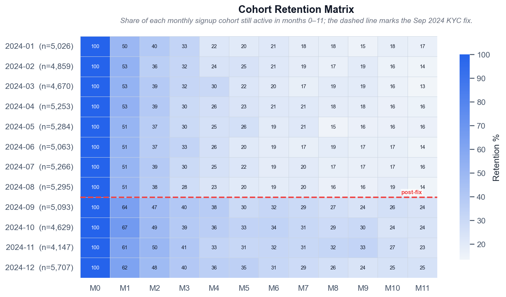
*Удержание по когортам регистрации. Рост вдоль диагонали — след фикса онбординга, а не разовой аномалии.*

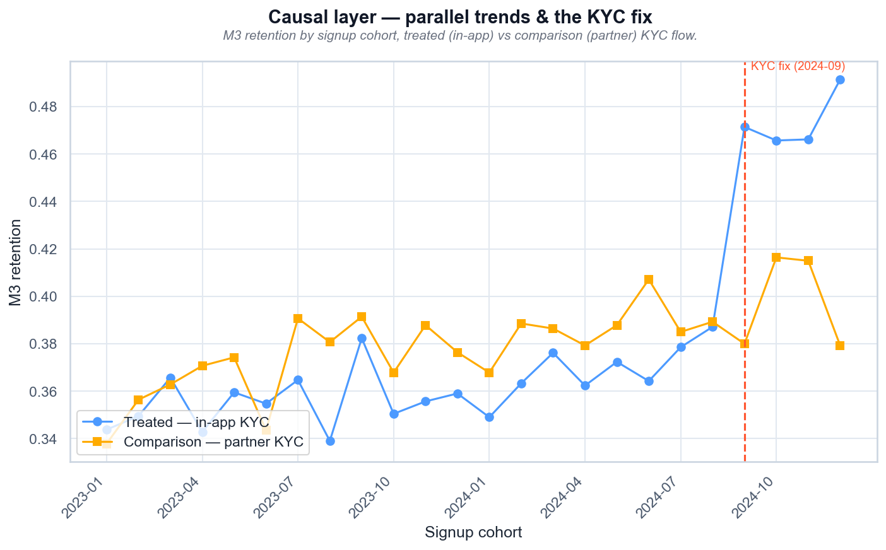
*Динамика активации по группам вокруг выката. Параллельность трендов до вмешательства и расхождение после — аргумент за причинность, а не корреляцию.*

### Выручка сконцентрирована

12% пользователей (Power) дают 41% выручки, 68% — 92%. Число сегментов
выбрано из данных, а не назначено: elbow-правило плюс валидация силуэтом
дали K=4.


*Доля сегмента в месячной выручке и кумулятивная кривая вклада. Порог 80% выручки достигается на 68% пользователей.*


*K выбирается по данным: перегиб инерции и максимум силуэта сходятся на K=4.*

### Путешественники теряют деньги

Минус €0,45 на каждые €100 FX-операции. Безубыточность требует опустить
FX-cost с 1,0% до 0,55%, а такая цена доступна только на объёме ~€332 млн в
месяц — это в 122 раза больше текущего.

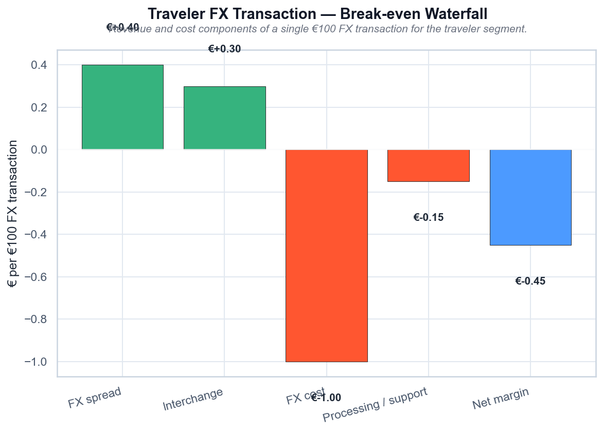
*Выручка и издержки одной операции на €100. Итог — минус €0,45: сегмент субсидируется за счёт остальных.*

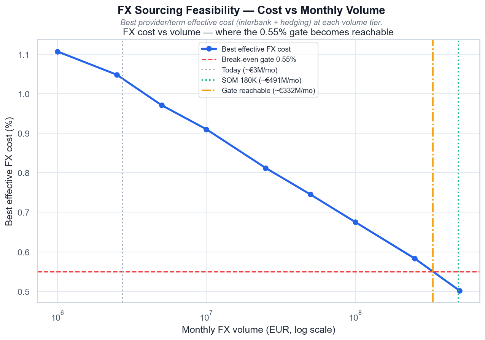
*Цена вендора падает с объёмом. Целевые 0,55% достижимы лишь около €332 млн в месяц — в 122 раза больше текущего объёма.*

### Правки не переносятся на новые сегменты

Premium-апселл: якорь 17% против цифровых новичков 45+ 2%. Реферал: 29,6%
против 4,8%. Фикс KYC дал 35–44 годам +11,0 п.п., а 45+ — только +1,4 п.п.
(p = 0,59). Барьер 45+ — доверие, а не интерфейс.


*Прирост активации от фикса KYC по возрастным группам. Ядро 35–44 отвечает сильно, 45+ — статистически никак.*

> **Оговорка о данных.** Значение `p = 0,59` для 45+ — авторитетное: оно
> посчитано по сырым `data/volta_ab_experiment.csv` (t-тест Уэлча, p = 0,5934;
> χ² без поправки Йетса — 0,5931). Файл `data/segment_results.csv` устарел
> относительно этой цифры: его колонка `p_value` использует χ² с поправкой
> Йетса (для 45+ — 0,6294). Вывод не меняется (эффект незначим), но CSV следует
> перегенерировать. Подробности — [`data/segment_results.README.md`](data/segment_results.README.md).


*Абсолютный лифт конверсии с 95% ДИ. Gap-сегменты дают в 3,9–4,8 раза больше якоря; значимы 3 из 3 после поправки Holm.*

### Но сегментный оффер работает

Свой оффер вместо общего поднял конверсию на 3,33 п.п. у 45+, на 4,16 п.п. у
семейных бюджетов, на 3,79 п.п. у путешественников — все значимы после
поправки Holm. Разрыв сузился, но не закрылся: generic-оффер якоря всё ещё
втрое сильнее.

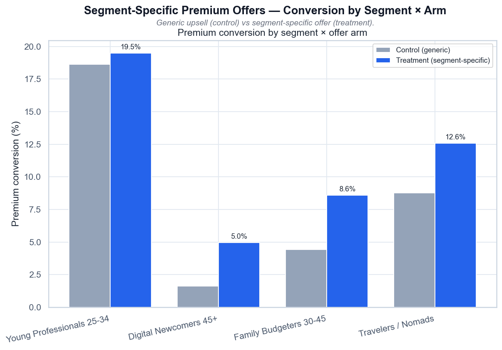
*Конверсия по сегменту и плечу. Сегментный оффер сужает разрыв, но не убирает его.*

### Win-back окупается только в узком окне

Light-touch возвращает деньги на глубине 30–90 дней (ROI 2,54 и 1,26), а
человеческий звонок не окупается нигде (максимум 0,92 при €11 на пользователя).

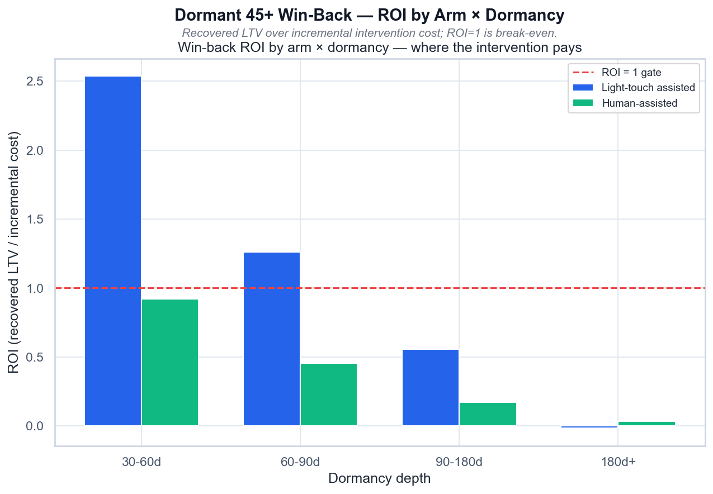
*ROI по arm × глубине; ROI = 1 — окупаемость. Выше линии — только light-touch на 30–90 днях.*


*Доля вернувшихся по плечу и глубине. Звонок даёт больше реактиваций, но не покрывает свою стоимость.*

### Запуск якоря ломается на масштабе

LTV/CAC ≥ 3 держится только до ≈ 70K пользователей — пока не исчерпаны
referral и дешёвый in-app. На SOM (225K) blended LTV/CAC падает до 1,76.

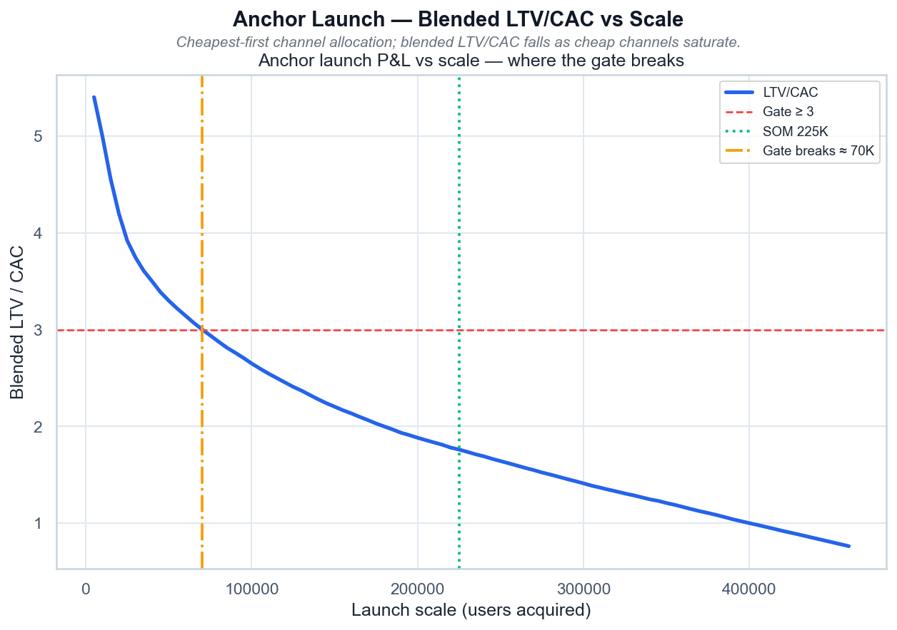
*Гейт ≥ 3 держится до ≈ 70K пользователей, дальше blended метрика падает под напором дорогого маржинального CAC.*


*Последний пользователь SOM приходит из partner/paid по €100–368. Рычаг — ёмкость дешёвых каналов, а не бюджет.*

---

## Решения и гейты

| Инициатива | Доказательство | Гейт | Решение |
|---|---|---|---|
| Прогресс-бар KYC | +5,72 п.п., p < 0,0001 | p < 0,05, лифт ≥ MDE, нет SRM | **Выкатить** на 100% |
| Сегментные premium-офферы | +3,3…+4,2 п.п. после Holm | лифт > 0 после поправки | **Выкатить**, помня про остаточный разрыв |
| Light-touch win-back 30–90 дней | ROI 2,54 (30–60 дн), 1,26 (60–90 дн) | ROI ≥ 1 | **Выкатить** узко |
| Trust-трек 45+ | LTV/CAC 0,66, payback 50 мес | LTV/CAC ≥ 3, payback ≤ 12 мес | **Придержать** — снижать CAC |
| Масштабирование тревел-сегмента | маржа < 0, гейт €332 млн/мес | FX-cost ≤ 0,55% | **Придержать** — пилот на 10% сегмента |
| Запуск якоря до SOM | LTV/CAC 1,76 на SOM | LTV/CAC ≥ 3 | **Придержать** — планировать до 70K |
| Human-звонок win-back | ROI 0,40 | ROI ≥ 1 | **Убрать** как массовый канал |

### Порядок действий

1. **Выкатить прогресс-бар KYC на 100%** — самый дешёвый и самый доказанный
   рычаг: 44× ROI, эффект подтверждён и в когортах, и каузальным тестом.
2. **Добавить сегментный premium-оффер** там, где generic провалился (45+,
   семьи, тревел) — лифт значим после Holm, но якорь трогать не нужно.
3. **Сузить win-back до 30–90 дней** через light-touch; звонок убрать как
   массовый канал и оставить точечной эскалацией для high-value.
4. **Не масштабировать тревел-сегмент** до пересмотра FX-cost; вместо этого
   пилот на 10% сегмента с целевым соглашением по интербанковской ставке.
5. **Сдвинуть план запуска якоря** к 70K пользователей — до этой точки
   экономика проходит гейт LTV/CAC ≥ 3, после — нет.

---

## Быстрый старт

```bash
# зависимости: dev-группа несёт ruff, mypy и pytest
uv sync --all-groups

# синтетические датасеты — seeded, воспроизводимо
make data

# тесты, линт и типы разом
make all

# или один анализ, из корня репозитория
PYTHONPATH=.:scripts uv run python scripts/volta_funnel_analysis.py
```

`make data` прогоняет генераторы и перезаписывает `data/`, PNG попадают в
`outputs/`. Отдельные цели: `make test`, `make lint`, `make type`,
`make notebooks`, `make board`.

---

## Стек и структура

| Слой | Чем сделан |
|---|---|
| Данные | pandas, numpy |
| Статистика и ML | scipy, scikit-learn, shap |
| Визуализация | matplotlib, seaborn |
| Отчёты | openpyxl, pdfplumber, pypdf |
| Инструменты | uv, ruff, mypy, pytest, pre-commit |

```text
volta-banking/
├── scripts/    анализы volta_*.py и seeded-генераторы данных
├── tests/      pytest: unit-тесты и smoke на каждый main()
├── utils/      общие хелперы — setup, print_section, data_path
├── data/       синтетические CSV, лежат в репозитории
├── outputs/    PNG-визуализации, лежат в репозитории
├── notebooks/  исполненные ноутбуки проектов 1–4
├── docs/       PRD, ADR и HTML-борд
└── Makefile    data | test | lint | format | type | board | all
```

Каждый `volta_*.py` устроен как «функции + `main()`»: импорт модуля не
запускает анализ. Общие константы и хелперы живут в `utils/common.py`, чтобы
скрипты не разъезжались в допущениях.

<details>
<summary>Методология — что именно считается</summary>

- **Воронка** — пошаговая конверсия, абсолютный и относительный провал,
  хи-квадрат по каналам, интервалы Уилсона на конверсию шагов.
- **A/B** — размер выборки, проверка SRM, bootstrap-ДИ, поправки
  Бонферрони/Holm/BH, AA-тест под H₀, снижение дисперсии CUPED,
  чувствительность на MDE вместо устаревшей пост-хок мощности.
- **Retention** — когортные кривые, pre/post Welch-тест с Cohen's d,
  bootstrap-ДИ, разложение LTV на ARPU × удержание.
- **Сегментация** — StandardScaler + KMeans, K из данных, силуэт по кластерам,
  PCA-проекция, концентрация по Лоренцу, чувствительность к оттоку.
- **Причинность** — difference-in-differences, HTE по подгруппам с поправкой
  Holm, рандомизированные A/B на сегментных офферах и win-back.
- **Деньги** — LTV на пользователя, blended CAC по сегменту и каналу,
  LTV/CAC с bootstrap-ДИ, payback в месяцах, безубыточный объём, ROI на
  10 000 обработанных.

</details>

---

## Визуализации — остальные проекты

| Churn: важность признаков | Атрибуция: модели |
|---|---|
| 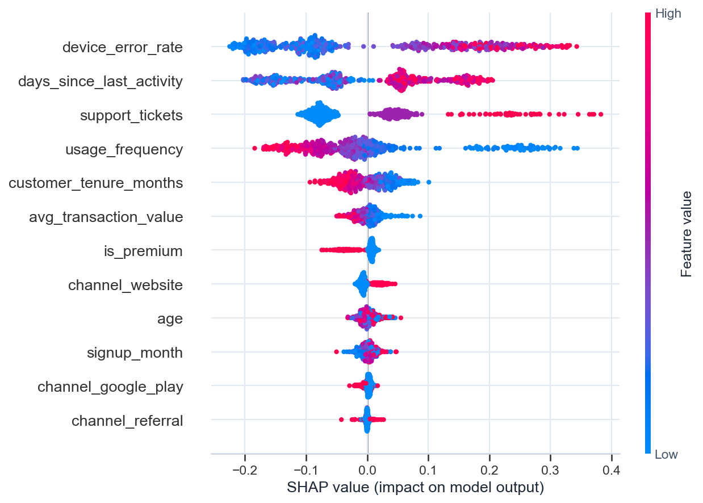 | 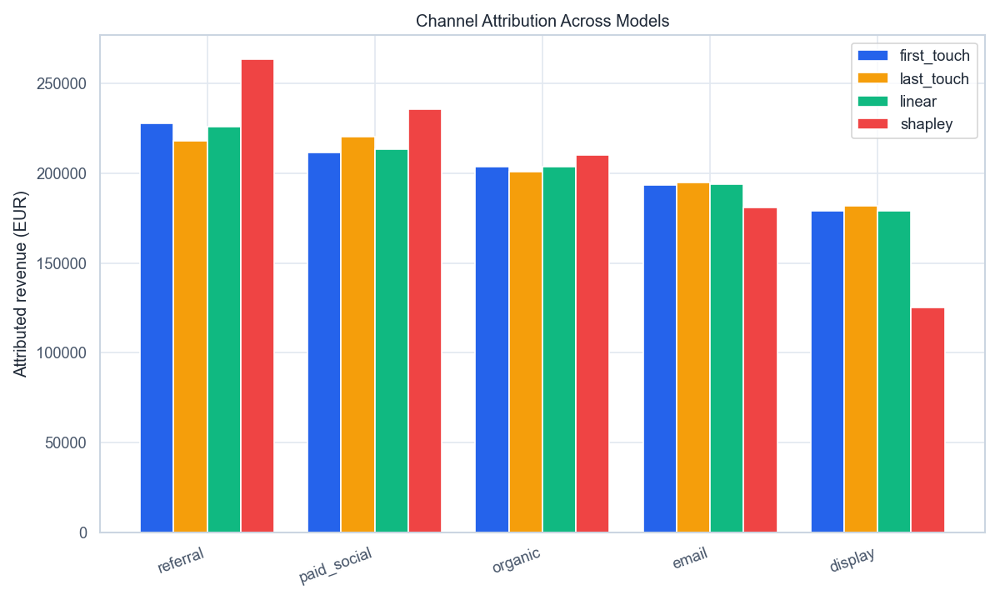 |

| RFM-сегменты | NPS: драйверы |
|---|---|
| 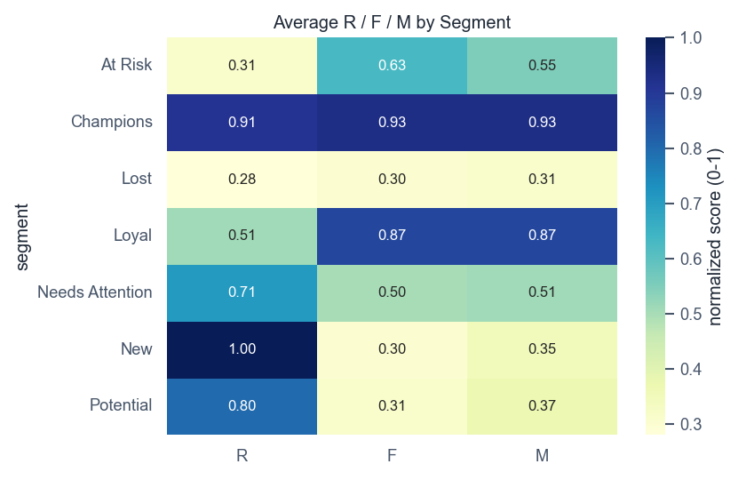 | 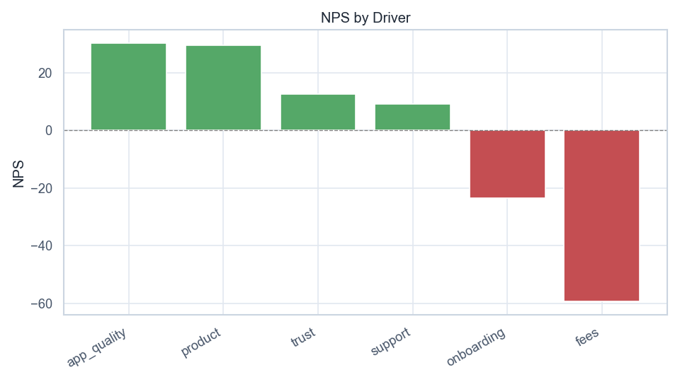 |

| Аномалии метрик | Траты по категориям |
|---|---|
| 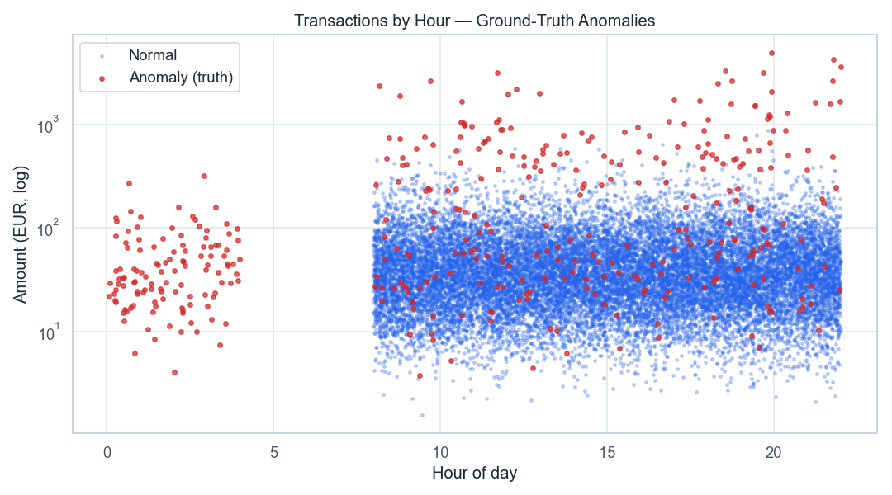 | 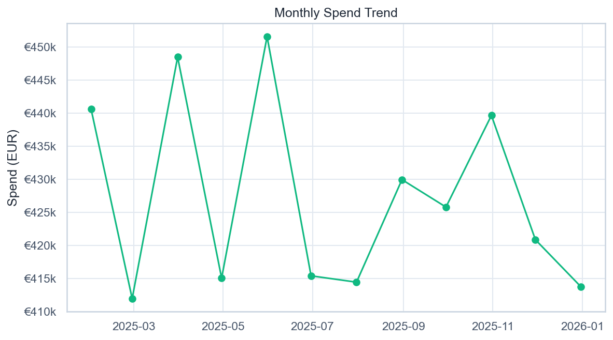 |

| Поддержка и отток | JTBD × когорты |
|---|---|
| 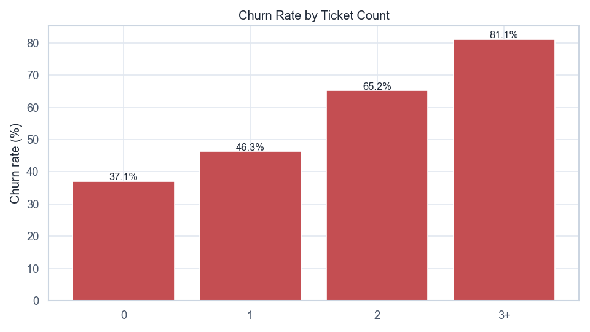 | 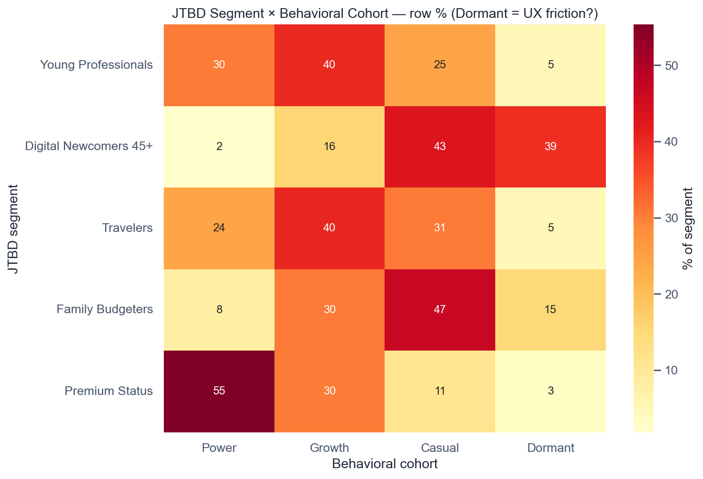 |

| Assisted LTV/CAC по сегменту и каналу | Рейтинг FX-провайдеров |
|---|---|
| 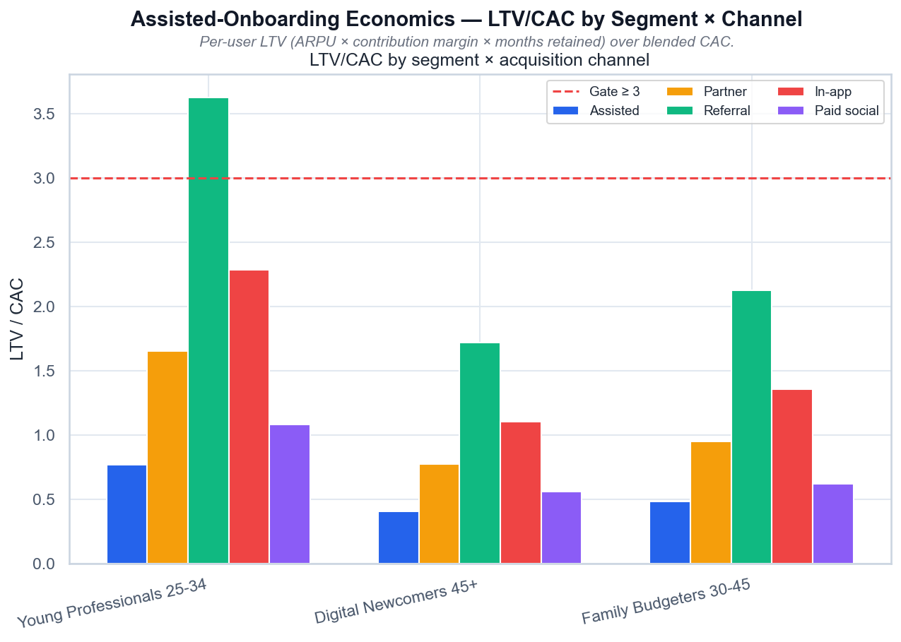 | 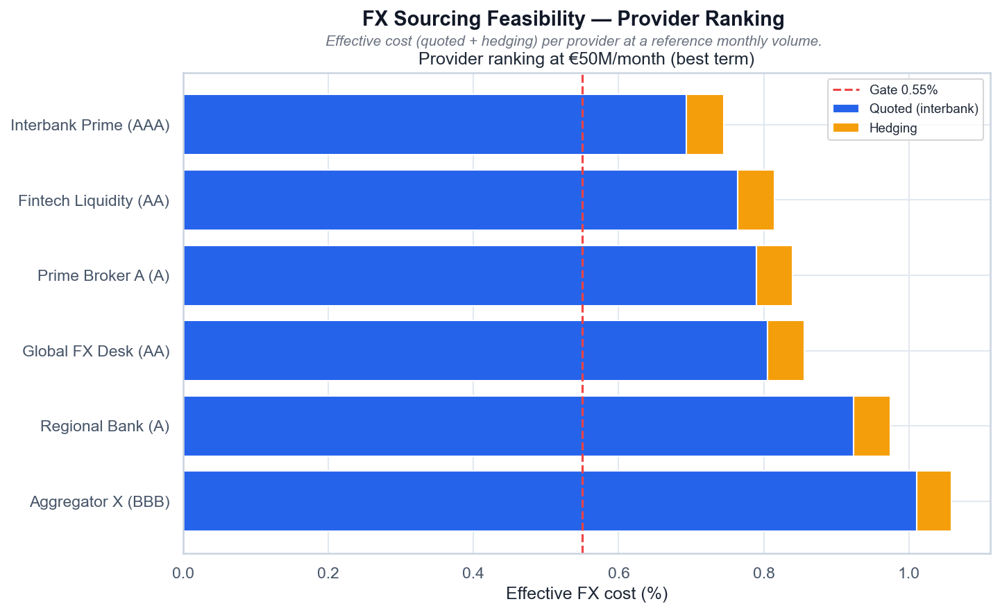 |

| Чувствительность юнит-экономики тревела | Реферальные сегменты |
|---|---|
| 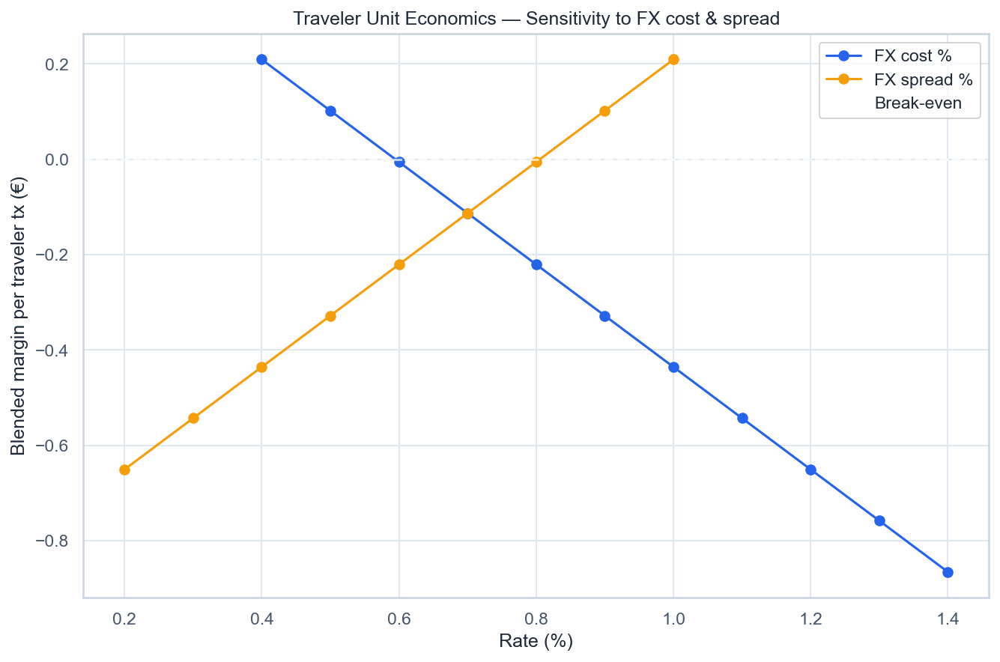 |  |

| CLV: сравнение методов | Разбивка воронки по каналам |
|---|---|
| 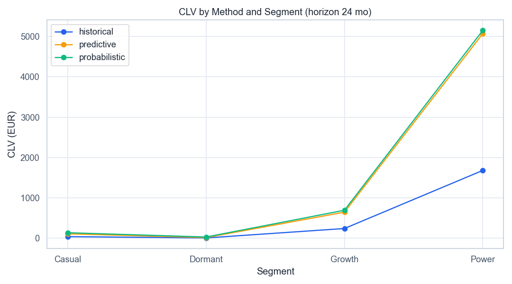 |  |

---

## Где читать дальше

- **[Аналитический борд](docs/board/volta_board.html)** — все 22 проекта на одной
  странице, без установки.
- **[PRD v2](docs/prd-v2.md)** — что входило в ограниченное переоткрытие
  портфолио. Запись о решении: [ADR 0001](docs/adr/0001-bounded-reopen-volta-2.0.md).
- **`notebooks/`** — исполненные ноутбуки проектов 1–4 с выводами по шагам.
- **[`docs/portfolio-full.md`](docs/portfolio-full.md)** — полная версия README:
  таблицы по каждому из 22 проектов, RAT v1 и v2, методология по всем разделам.
- **`outputs/*.md`** — под каждой картинкой лежит одноимённый markdown с
  выводами и ссылкой на скрипт-источник.

---

*Синтетические данные · образовательное портфолио · seeded-генераторы для
воспроизводимости.*
