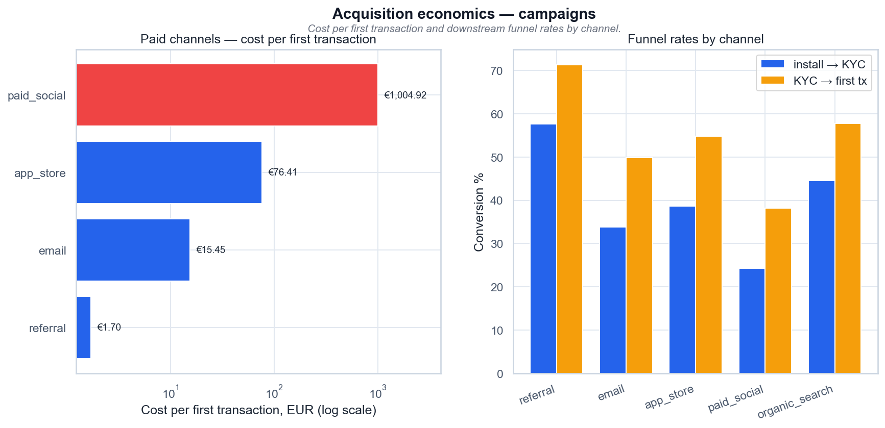

# Acquisition economics — campaigns

*Стоимость первой транзакции по каналам кампаний и конверсия установка → KYC → первая транзакция.*

## Выводы

- Самый дешёвый первый платёж — referral: €1,70 медиазатрат; самый дорогой — paid_social: €1 004,92 (в 590 раз дороже).
- organic_search идёт с нулевыми записанными расходами: его стоимость — «н/д», а не €0; генератор не пишет медиазатраты для органика.
- Конверсия install → KYC у referral — 57,7%, у paid_social — 24,2%.
- Правый график показывает, что дорогой канал проигрывает уже на входе в KYC, а не только на последнем шаге.

---
Источник: `scripts/volta_feature_adoption.py` · данные: `data/volta_campaigns.csv`
