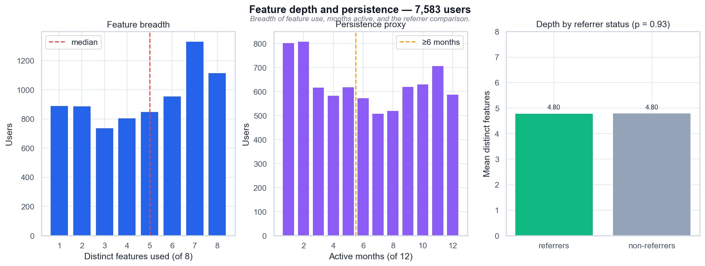

# Feature depth and persistence — 7,583 users

*Широта использования функций, число активных месяцев и сравнение рефереров с остальными пользователями.*

## Выводы

- Медиана глубины — 5 из 8 функций; 56,2% пользователей используют ≥5 функций.
- Медиана активности — 6 месяцев из 12; 54,7% активны ≥6 месяцев, 78,3% — в IV квартале.
- Глубина и число активных месяцев коррелируют (r = 0,92) — это одна метрика вовлечённости, а не две независимые.
- Рефереры и не-рефереры не различаются по глубине (4,80 против 4,80; p = 0,93).

---
Источник: `scripts/volta_feature_adoption.py` · данные: `data/volta_feature_events.csv · data/volta_referrals.csv`
