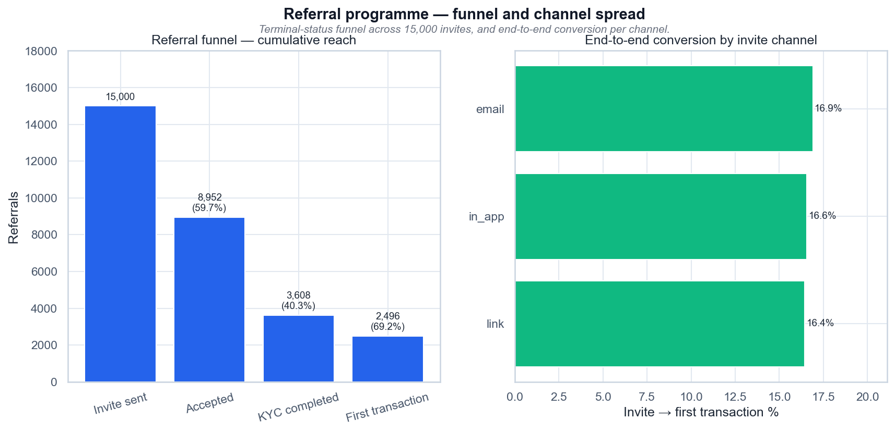

# Referral programme — funnel and channel spread

*Воронка реферальных приглашений по терминальному статусу и сквозная конверсия по каналу приглашения.*

## Выводы

- Из 15 000 приглашений до первой транзакции доходят 2 496 — 16,6%.
- Самое узкое место — accepted → KYC: 40,3% (3 608 из 8 952).
- Вознаграждение: €61 040 на 2 496 активированных рефералов = €24,46 за первого.
- Разброс между каналами приглашения — 0,5 п.п.; рекомендация по каналу приглашения не обоснована.

---
Источник: `scripts/volta_feature_adoption.py` · данные: `data/volta_referrals.csv`
