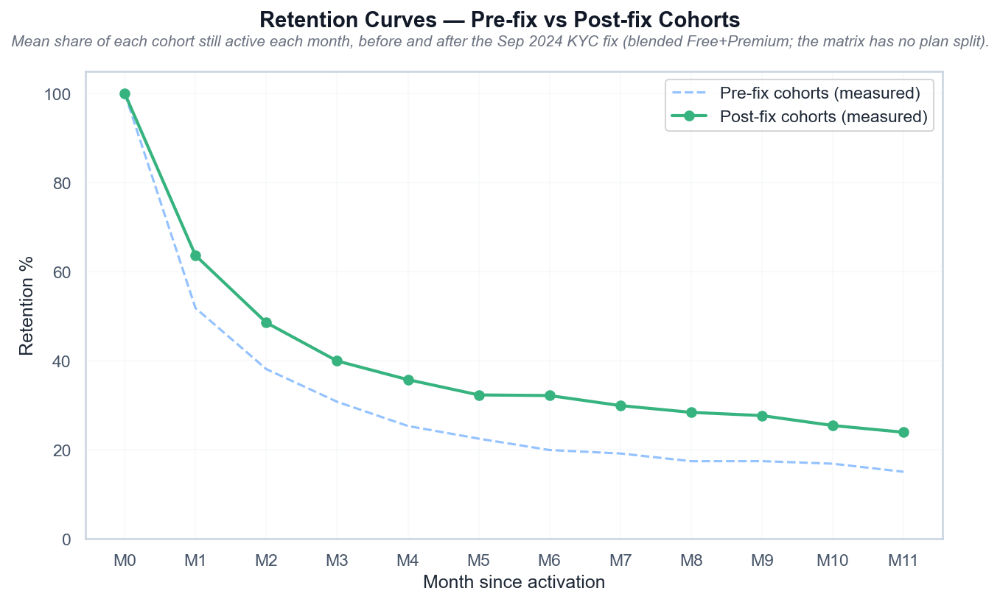

# Retention Curves — Pre-fix vs Post-fix Cohorts

*Средняя доля активных пользователей по месяцам до и после починки KYC (Free+Premium вместе: разреза по тарифу в данных нет).*

## Выводы

- M6-удержание: 20% до фикса и 32% после (+12 п.п.); обе кривые — средние по когортам файла.
- Кривые построены из data/cohort_retention_matrix.csv, а не из констант в коде.
- Тарифный разрез недоступен: матрица не различает Free и Premium, поэтому LTV тарифов отличается только через ARPU, а не через удержание.

---
Источник: `scripts/volta_retention_analysis.py` · данные: `data/cohort_retention_matrix.csv`
